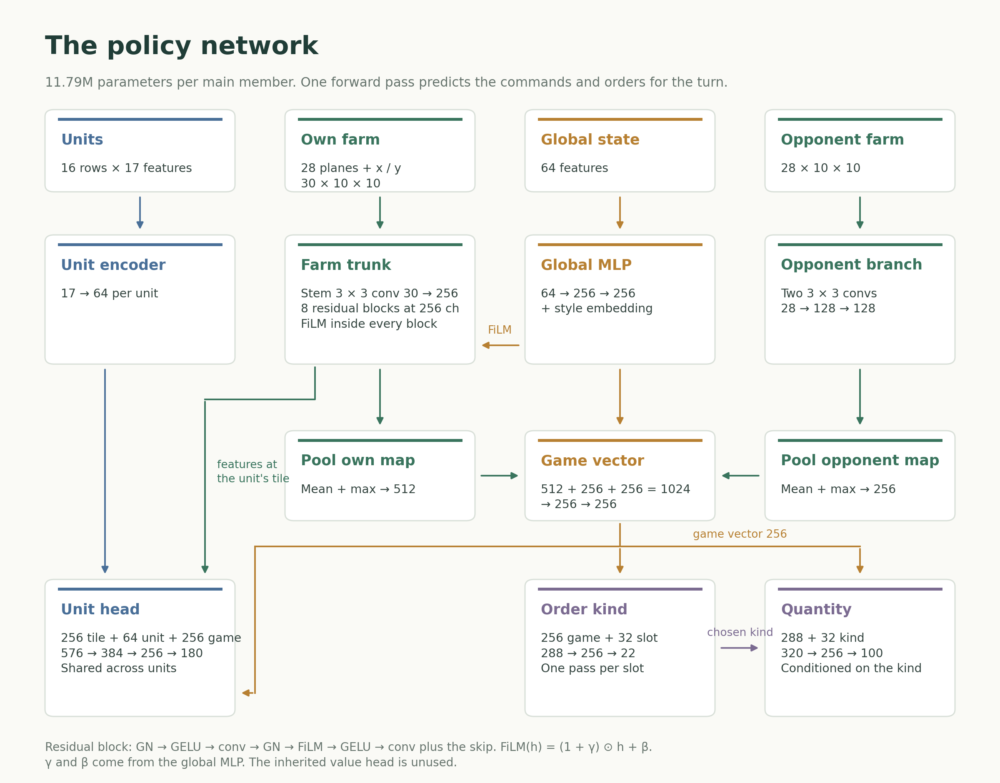

# Kaggriculture: a farming agent cloned from public replays

Team Smackaveli · 47th of 10,148 on the final leaderboard · [Write-up](https://www.kaggle.com/competitions/kaggriculture/writeups/47th-place-teaching-a-farming-agent-from-replays) · [Final agents](https://www.kaggle.com/datasets/spoutop/kaggriculture-smackaveli-final-agents)

Training and evaluation code for our Kaggriculture agent. The policy is an 11.79M-parameter convolutional network trained by behaviour cloning on public replays. Five such networks play as a log-probability ensemble through a numpy-only decoder on Kaggle's CPU workers. The weights of our two final submissions are on Kaggle. See Final agents.



Training has three stages. Each one starts from the previous checkpoint.

1. Pretrain on 18,667 game-seats from many teams. 24 epochs.
2. Fine-tune on one reference team. 1,150 seats from selected versions of that team with newer games weighted up. 40 epochs.
3. Refresh on that team's recent games with extra weight on games against opponents rated 2,800 and above. 24 epochs with late-game steps drawn more often.

The exact commands are in `configs/`. The write-up walks through one recorded turn and the figures in `assets/`.

## Final agents

The two agents in play when the competition locked are in the Kaggle dataset [kaggriculture-smackaveli-final-agents](https://www.kaggle.com/datasets/spoutop/kaggriculture-smackaveli-final-agents) (CC BY 4.0):

| folder | submitted (UTC) | main members |
|---|---|---|
| sub-2026-09-30-1944 | 2026-09-30 19:44 | FS3W seeds 311 / 312 / 313 + PXLT seeds 299 / 301 |
| sub-2026-09-30-1957 | 2026-09-30 19:57 | T28 seeds 296 / 297 / 298 + PXLT seeds 299 / 301 |

Each folder is a ready agent: `main.py` plus four policy modules and the weights of five main members and six smaller alternates. `configs/ensemble_A.json` is the first one's member list. The weights are byte-identical to the submitted files.

```python
from kaggle_environments import make

env = make("kaggriculture", configuration={"seed": 42})
env.run(["sub-2026-09-30-1944/main.py", "random"])   # main.py finds its modules and weights next to itself
print([s.reward for s in env.steps[-1]])
```

## Layout

```
src/
  codec.py              action vocabulary (159 unit classes and 22 order kinds) with legality masks and label encode / decode
  encoder.py            observation -> 28 planes per farm plus unit rows and the 64-number global vector (numpy only)
  model.py              the torch network: 3 x 3 stem and 8 residual blocks at 256 channels with FiLM from the globals and the heads
  np_policy.py          the same forward pass in numpy on exported weights (int8 trunk and float16 heads dequantised at load)
  np_ensemble.py        log-probability ensemble and the decode layers: score offsets (Correction) and the missing-order rule and
                        the stock rules and the opening detector (DetectorSwitch) and the opening book (BookWrap)
  lean_engine.py        the reference interpreter from kaggle-environments driven without the Environment wrapper
  bc_data.py            replay JSON -> one .npz shard per (game, seat) by exact replay in the lean engine
  make_allow_by_sub.py  shard -> submission (version) index from the episode listings
  make_split.py         per-version allow lists and the chronological split and the recency weights
  validate_replays.py   drops incomplete or errored replays
  dl_daily.sh           fetches Kaggle's daily episode dumps
  bc_train.py / bc_train2.py / bc_train_hp.py   the trainer in its three generations; stages 1 and 2 use bc_train2 and stage 3 uses bc_train_hp
  vocab_adapt.py        loads an older checkpoint into a wider vocabulary
  swa_ckpt.py           uniform weight average over a window of epochs
  a5_select.py / a5_select_v3e.py   export (checkpoint -> baked numpy policy) and paired-seed play against frozen opponents
  q8.py / fsq8_quant.py  per-output-channel int8 quantisation of a baked member
  make_bundle_ens.py    members + offsets + book (+ alternates and detector) -> a self-contained Kaggle bundle
  preflight_bundle.py / first_step_latency.py / np_parity.py / bundle_parity_book.py   the checks every upload passed
  paired_bar.py         paired seed-clustered standard error for A/B reads
  fid_eval.py           teacher-forced fidelity of a checkpoint on held-out seats
  gt9.py                ghost-tape panel: the candidate takes the reference seat of a recorded game while the opponent replays its tape
  ens_sel.py            greedy forward ensemble selection on paired games
  es_search.py / es_search_r2.py / es_gpu.py / es_finalists.py / make_stage2.py   evolution strategies over the decode-time offsets
  book.py               exact-state opening book built from the reference team's recorded openings
configs/
  stage1_pretrain.sh / stage2_reference_team.sh / stage3_weighted_refresh.sh / build_bundle.sh
  correction_final.json   the shipped score offsets
  detector_final.json     the shipped opening detector (a rule on the opponent's money at steps 1 and 2)
  book_params.json        the opening book gate
  ensemble_A.json         member list of the first final submission
  late_shards_example.json
assets/                   the write-up figures
```

Scripts import each other by file name. Run them from `src/`.

## Setup

```
pip install -r requirements.txt
```

Training needs a CUDA GPU. Everything else runs on CPU. Tested with Python 3.11 and PyTorch 2.14 and numpy 2.4 and kaggle-environments 1.32.7.

Replay readers look for data under `KGR_ROOT` (default: the current directory). The sparring opponents built from public notebooks live under `KGX_ROOT` and are not part of this release.

## Data

The input is the set of episode replay JSON files that kaggle-environments writes. Kaggle published them daily as CC0 datasets and `dl_daily.sh` fetches them.

```
bash dl_daily.sh 2026-09-27 2026-09-28
python validate_replays.py 'replays/daily_*/episodes/*.json.gz'
python bc_data.py 'replays/daily_*/episodes/*.json.gz' --team TEAM --out data/TEAM     # one shard per (game, seat)
python make_allow_by_sub.py                                                          # shard -> submission index
python make_split.py --team-token 5 --shards data/ref --current SUB_ID,... --recent SUB_ID,... --lam 2.0
```

Every shard carries the encoded state before each step and the recorded action as labels and the legality masks of that step. Recorded actions the engine would have refused are relabelled PASS or NONE. Team names in this release are replaced by labels (TB and REF and so on). Edit `TEAMS` in `bc_data.py` to map the names in your replays.

## Training

```
SEED=311 bash configs/stage1_pretrain.sh
SEED=311 W=3 bash configs/stage2_reference_team.sh
SEED=311 E2=29 E3=21 bash configs/stage3_weighted_refresh.sh
```

Loss is the sum of three cross-entropies over legal choices only: unit command and market kind and 0.5 times market quantity. The quantity head sees the recorded kind in training and the predicted kind at play. Stages 2 and 3 draw 300 shards per epoch with replacement with probability proportional to a recency weight. Stage 3 draws late-game steps more often from day 20. Checkpoints were chosen by full games against cloned opponents (`a5_select_v3e.py play` with `paired_bar.py`) rather than by validation loss.

Export bakes the team token and a sampling temperature of 0.5 into the weights so the numpy policy needs neither. `q8.py` then stores the trunk as int8 with one float32 scale per output channel. That kept a five-member bundle under Kaggle's 100 MiB upload cap.

## Building and checking a submission

```
bash configs/build_bundle.sh
```

`make_bundle_ens.py` writes `main.py` and copies the four policy modules under a prefix hashed from the bundle contents so two bundles can never share a module name in one process. The checks: a fresh-process first-step latency read. Kaggle's own loader on `main.py` plus one official self-play episode. Torch versus numpy parity on recorded states. Bundle versus evaluated-policy parity on full lean-engine games with the opening book on.

## Model

Inputs are seat-relative. Our farm is 28 planes over the 10 x 10 board (crop and age and watered and yield and units on the tile and more). The opponent's visible farm is another 28. Each of up to 16 units is a row of 17 numbers (position and inventory and index). The 64 global numbers hold the clock and both players' money and seeds and shed stock and prices relative to base and market stock relative to a reference and the town's shops.

The trunk is a 3 x 3 stem and eight residual blocks at 256 channels with GroupNorm. FiLM from the global vector scales and shifts the features inside every block. The opponent's farm passes through a smaller branch before pooling. Every unit uses the same head: the trunk features at the unit's tile plus the unit's row plus the pooled game summary -> 159 unit classes. Each of the ten market slots has its own kind head (22 kinds). A quantity head conditioned on the chosen kind predicts 1 to 100. The value head is inherited from an earlier RL track and unused.

Decoding in play: the members' log-softmax outputs are averaged. Score offsets per order kind and game phase are added (`correction_final.json`). Argmax under legality masks. Planting shares a seed budget. A missing-order rule appends likely kinds no slot chose. Overflow is sold before the shed fills and the last turns liquidate stock. At step 2 a rule on the opponent's money can hand the game to the six alternates. An exact-state opening book can replace the base action under its gate. A time guard drops members when the per-step charge threatens Kaggle's 60-second reserve.

## Evaluation

Every gate and selection used paired games: the same seeds on both seats for every candidate with a seed-clustered standard error (`paired_bar.py`). Three judges:

- `a5_select_v3e.py play`: full games on the lean engine against frozen opponents (cloned ensembles and public-notebook agents).
- `gt9.py`: the candidate takes the reference team's seat in a recorded ladder game while the opponent replays its recorded actions. Divergence from the recording is measured per game.
- `fid_eval.py`: teacher-forced top-1 and NLL on held-out seats. It ranked some checkpoints wrongly in play and so it never decided an upload on its own.

The decode-time offsets came from `es_search_r2.py`: evolution strategies over a 58-coordinate correction scored by paired games against the uncorrected ensemble and a panel of clones. `es_gpu.py` runs those games in lockstep with the member forwards batched on a GPU. Pass `--engine lean` since the C++ engine port it defaults to is not in this release.

## Acknowledgements

kaggle-environments (Apache 2.0) for the game engine that `lean_engine.py` drives directly. Kaggle's daily episode dumps (CC0) for the replays.

## License

MIT for the code in this repository. The released weights on Kaggle are CC BY 4.0.
